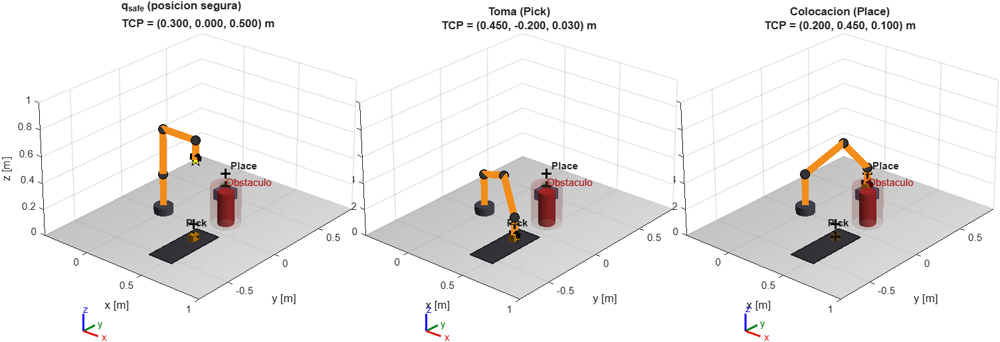

# Robot Pick & Place de 5 GDL (simulado)

Modelo de un brazo robótico simulado de 5 grados de libertad para una tarea Pick & Place:
geometría, cinemática directa, configuraciones de referencia, visualización 3D y
pruebas que comprueban que Python y MATLAB representan el mismo robot.

Este repositorio documenta **solo el funcionamiento del robot**. No incluye
optimización ni análisis económico.

## El robot

Variables: `q = [θ1, θ2, θ3, θ4, θ5]` (ángulos de las juntas).

| Junta | Función | Rango |
|---|---|---|
| θ1 | Base: gira todo el brazo alrededor de la vertical | −170° a 170° |
| θ2 | Hombro: sube o baja el brazo | 0° a 180° |
| θ3 | Codo: dobla el antebrazo | −150° a 150° |
| θ4 | Muñeca: inclina (cabeceo) la pinza | −135° a 135° |
| θ5 | Pinza: gira los dedos alrededor de su eje | −180° a 180° |

Geometría: `d1 = 0.30 m` (altura del hombro), `a2 = 0.35 m` (brazo),
`a3 = 0.30 m` (antebrazo), `d5 = 0.15 m` (muñeca a la punta de la pinza).

Velocidades máximas por junta: 120, 120, 150, 180 y 180 °/s; aceleraciones máximas:
300, 300, 400, 500 y 500 °/s². Son parámetros de diseño del robot simulado, no de un
fabricante.

## Cinemática directa (seno y coseno)

Una barra de largo `L` con ángulo `θ` avanza `L cos θ` en horizontal y `L sin θ` en
vertical. En el plano del brazo los ángulos se acumulan:

```
r = a2 cos θ2 + a3 cos(θ2+θ3) + d5 cos(θ2+θ3+θ4)
z = d1 + a2 sin θ2 + a3 sin(θ2+θ3) + d5 sin(θ2+θ3+θ4)
x = r cos θ1,   y = r sin θ1

φ = θ2 + θ3 + θ4   inclinación de la pinza (−90° = hacia abajo)
ψ = θ1 − θ5        giro de la pinza alrededor de la vertical
```

Comprobación conocida: `q_safe = [0°, 90°, −90°, −90°, 0°]` coloca la punta en
`(0.30, 0, 0.50) m` con la pinza hacia abajo.

La formulación Denavit-Hartenberg se usa solo como comprobación independiente
(`python/validacion_robotica.py` y el `rigidBodyTree` de MATLAB):

| i | a | α | d | θ |
|---|---|---|---|---|
| 1 | 0 | +90° | d1 | θ1 |
| 2 | a2 | 0 | 0 | θ2 |
| 3 | a3 | 0 | 0 | θ3 |
| 4 | 0 | +90° | 0 | θ4 + 90° |
| 5 | 0 | 0 | d5 | θ5 |

## Escenario

| Elemento | Valor |
|---|---|
| Toma (Pick) | (0.45, −0.20, 0.03) m, ψ = 0° |
| Colocación (Place) | (0.20, 0.45, 0.10) m, ψ = 0° |
| Obstáculo | cilindro de radio 0.06 m y altura 0.25 m en (0.45, 0.15) m |
| Aproximación | 0.10 m sobre la toma y sobre la colocación |
| Holgura mínima | 0.05 m al obstáculo y al piso |

Todo se lee de `config/escenario.json`, la única fuente de datos para Python y MATLAB.

## Estructura

```
config/escenario.json              geometría, límites y escenario
python/parametros.py               lee el JSON (SI y radianes)
python/cinematica.py               cinemática directa y puntos del brazo
python/validacion_robotica.py      Denavit-Hartenberg y cinemática inversa analítica
python/exportar_referencia_fk.py   tabla de referencia para MATLAB
python/exportar_configuraciones.py configuraciones de toma y colocación para la demo
python/ejecutar_pruebas.py         ejecuta las pruebas (sin dependencias externas)
python/pruebas/                    pruebas de configuración y cinemática
matlab/construir_robot.m           robot 3D (rigidBodyTree) desde el mismo JSON
matlab/validar_fk.m                compara la cinemática de Python y MATLAB
matlab/demo_robot.m                dibuja el robot en q_safe, toma y colocación
resultados/                        CSV de referencia y figura de la demo
```

## Cómo ejecutar

Python (solo NumPy):

```
python python/ejecutar_pruebas.py
python python/exportar_referencia_fk.py
python python/exportar_configuraciones.py
```

MATLAB (Robotics System Toolbox para el `rigidBodyTree`):

```
addpath('matlab'); validar_fk; demo_robot
```

## Resultados de las pruebas

- Python: 12/12 pruebas superadas (geometría, límites, casos a mano, cinemática
  trigonométrica igual a Denavit-Hartenberg en 2000 configuraciones aleatorias,
  cinemática inversa analítica de toma y colocación).
- MATLAB: 9/9 pruebas superadas; la cinemática de Python y la del `rigidBodyTree`
  coinciden con error máximo del orden de 10⁻¹⁵ m.


